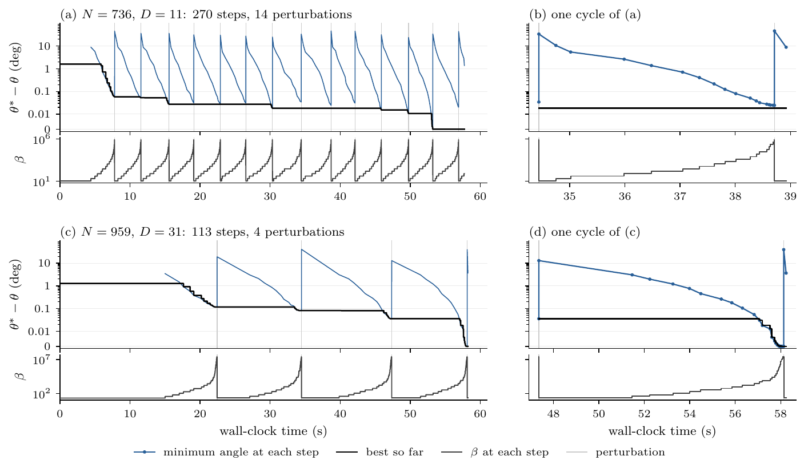

# Solver, parameters and certificates for "New spherical codes by tuning an annealing solver"

The spherical code problem asks how to place $N$ points on the unit sphere in $\mathbb{R}^D$ so that the smallest angle between any two of them is as large as possible. This repository contains the solver of the paper *New spherical codes by tuning an annealing solver* (Ilmari Vahteristo, 2026), its fitted parameters, and certificates for the 24 exact codes of the paper.

The solver anneals a LogSumExp surrogate of the largest pairwise cosine, minimizes it with L-BFGS-B, and perturbs the points with Student-$t$ noise between anneals. Seven parameters control it. The repository has one global parameter set and the parameters fitted separately for each of the 29,670 instances with $3 \le D \le 32$ and $2D < N \le 1024$. The results are in the paper, and the codes found are archived at https://doi.org/10.5281/zenodo.23270586. The code that fitted the parameters and the paper's post-optimization are not included.

## The solver

The largest pairwise cosine $f(X) = \max_{i<j} x_i^\top x_j$ is not smooth, so the solver minimizes the LogSumExp surrogate

$$\mathcal{L}_\beta(X) = \frac{1}{\beta}\log\sum_{i<j}\exp\bigl(\beta\, x_i^\top x_j\bigr),$$

which approaches $f$ as the hardness $\beta$ grows. One run on one instance is an *episode*, with a fixed wall-clock time limit:

```
X <- start; beta <- beta_min; beta_max <- r * beta_min
while time remains:
    X <- L-BFGS-B(L_beta, X, tolerance eps)        # one step
    keep X if its minimum angle is the best so far
    if beta < beta_max:
        beta <- min(beta * r^(1/s), beta_max)       # climb the ladder
    else:
        X <- perturb(X, sigma, nu)                  # Student-t noise
        beta <- beta_max^(1 - rho) * beta_min^rho   # roll back
return the best X
```

One climb of the ladder from $\beta_{\min}$ to $\beta_{\max}$ is an *anneal*. The perturbation moves every point along a tangent direction with a heavy-tailed Student-$t$ length, and the points stay on the sphere. The rollback $\rho$ sets how far down the ladder the next anneal starts; the fitted values are close to 1, so almost every anneal starts again from $\beta_{\min}$.



*Two 60-second episodes. Top of each panel: how far each step is from the best angle of the episode. Bottom: $\beta$ at each step. Gray lines: perturbations.*

The starting configuration is deterministic in $(N, D)$: a Sobol sample mapped to the sphere, reduced to $N$ points by greedy farthest-point sampling, and one L-BFGS-B call at $\beta = 100$. It is not counted towards the time limit. The surrogate and its gradient are computed in blocks of 128 rows of the Gram matrix, which uses 1.8 MiB instead of 44 MiB at $N = 1024$, $D = 32$ and runs 3 to 7 times as many L-BFGS-B iterations per second as a direct implementation.

## Install

    pip install .                           # numpy and scipy only; Python >= 3.10
    pip install -r requirements.txt .       # the same, with the NumPy and SciPy versions of the paper's runs; Python >= 3.12

## Run

    sphcode solve 60 5                            # per-instance parameters, 60 s
    sphcode solve 60 5 --params global
    sphcode solve 60 5 --params predictor
    sphcode solve 60 5 --time-limit 15 --seed 3 --out points.txt
    sphcode solve 60 5 --start my_points.txt      # start from your own configuration
    sphcode solve 60 5 --set rho=0.9 --set s=40
    sphcode solve 60 5 --cpu 3                    # pin the episode to core 3
    sphcode params 60 5 --params predictor        # print the parameters only

The command prints the best minimum angle found. `--out FILE.txt` writes the configuration with one point per line and comma-separated coordinates, and `--out FILE.npy` writes a NumPy array. `--start` reads both. `--trace` prints every step and perturbation. With `--start FILE` the solver starts from your points instead of its own starting configuration; they get the same first L-BFGS-B call, and the result is never worse than your input.

The per-instance parameters exist for the 29,670 fitted instances. `--params predictor` gives an instance the median parameters of its 16 nearest fitted instances in $(\log N, \log D)$, computed from the per-instance parameters. `--params FILE.json` reads a parameter set from a file with `{"params": {"beta_min": ..., ...}}`.

## The seven parameters

| parameter | `--set` name | role | search range | global value |
|---|---|---|---|---|
| $\beta_{\min}$ | `beta_min` | start of the anneal | 0.05 to 200 | 11.1 |
| $r$ | `r` | span $\beta_{\max}/\beta_{\min}$ | $10^2$ to $10^{10}$ | $7.5\times10^4$ |
| $s$ | `s` | steps from $\beta_{\min}$ to $\beta_{\max}$ | 2 to $10^4$ | 17 |
| $\sigma$ | `sigma` | perturbation scale (radians) | $10^{-6}$ to 1.5 | $1.0\times10^{-3}$ |
| $\nu$ | `nu` | perturbation degrees of freedom | 0.5 to 100 | 0.57 |
| $\rho$ | `rho` | rollback after a perturbation | 0.001 to 0.999 | 0.999 |
| $\epsilon$ | `eps` | L-BFGS-B stopping tolerance (SciPy's `ftol`) | $10^{-13}$ to $10^{-6}$ | $4.0\times10^{-8}$ |

Every command prints the resolved values. Inside an episode $\beta$ is capped at $10^9$ and $\sigma$ is kept between $2\times10^{-6}$ and $3$ times $N^{-1/(D-1)}$, as in the paper; a parameter set with $r\,\beta_{\min} > 10^9$ never perturbs. The printed values are before these two limits. `--set name=value` overrides one parameter on top of any source. The files store each parameter set as a vector u: `value = midpoint * exp(u)` for the six parameters searched as logarithms and `rho = sigmoid(u)` for the rollback, with the geometric midpoint of each range (`sphcode/parameters.py`).

## Parameter files (`sphcode/params/`)

- `global.json`: the global parameters, fitted with CMA-ES on 144 random instances with 60-second episodes.
- `per_instance.json`: for each of the 29,670 instances, its fitted parameters, the perturbation seed it was fitted at, and the angle its best fitting episode reached.

Both files record how they were fitted.

## Seeds and reproducibility

`--seed fit` (the default) uses the perturbation seed of the paper's fits on the instance, so `--params per-instance` reproduces the condition of the paper's fit. Any integer gives a fresh seed. The random draws of the perturbations are a function of (N, D, seed) and $\nu$; $\sigma$ only rescales them.

The time limit is wall clock. The number of L-BFGS-B iterations that fit into it depends on the machine and its load, so the same command on another computer gives a different configuration and angle. Even the first L-BFGS-B call lands on different last bits on different processors. The paper's runs used AMD EPYC 9965 nodes with 192 concurrent single-threaded episodes, Python 3.12.13, NumPy 2.5.1 and SciPy 1.18.0 (`requirements.txt`). Older NumPy and SciPy versions can give different results on the same machine. The package sets the BLAS thread variables to 1 when it is imported; import `sphcode` before numpy, and keep `OMP_NUM_THREADS` unset or at 1. As in the paper's runs, `sphcode solve` pins the episode to one CPU core (on Linux): the first core the process may run on, or the one given with `--cpu`.

## Test

    pip install ".[test]" && pytest -q

The tests include the 24 certificates.

## Certificates

The folder [`certificates/`](certificates/) holds an exact certificate for each of the 24 exact codes of the paper, and a script that checks them in rational arithmetic:

    pip install python-flint
    python certificates/verify_certificate.py certificates/*.json

## Citing

Ilmari Vahteristo, *New spherical codes by tuning an annealing solver*, 2026. This repository is archived at https://doi.org/10.5281/zenodo.23270597.

The public table: Henry Cohn, *Table of Spherical Codes*, https://hdl.handle.net/1721.1/153543.
